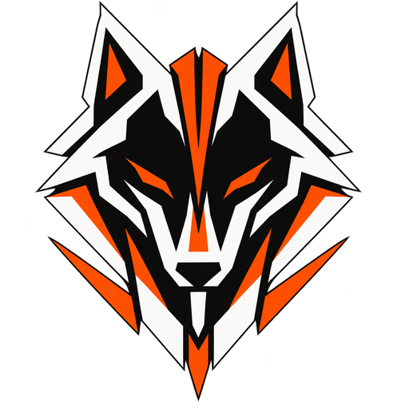

# Factions

Gravity Harvest has two playable factions: **Ordan** and **Sable**.

At the initial balance baseline, the factions differ mainly in how they look and sound: visual identity,
architecture, effects, sound, and unit and building design. Core economy, unit roles, costs, production timings
and combat relationships follow the balance spreadsheet (`design/balance.xlsx`) unless deliberately changed later.

Shared infrastructure uses the neutral Gravity Harvest visual language and isn't visually owned by either faction.

| | Ordan | Sable | Shared |
|---|---|---|---|
| Emblem | Bird of prey (white + violet) | Wolf head (white / charcoal + orange) | — |
| Energy colour | Violet / ultraviolet | Orange / ember | Electric blue |
| Main armour | Silver-white / pale ceramic | Dark gunmetal / charcoal | Off-white / light armour |
| Feel | Controlled gravity, precision engineering, disciplined power | Compressed power, industrial aggression, overwhelming force | Rugged common industry |

**Colour rule, everywhere** (buildings, units, weapons, UI, effects and every generated asset):
**blue = shared/common technology, violet = Ordan, orange = Sable.**

 

Emblems: `apps/game/public/assets/ui/factions/ordan.png` and `sable.png` (512 px; `_small` versions are 128 px).
Originals in `art/factions/`.

## Ordan

### Identity

Ordan stands for precision, control, discipline, and sophisticated manipulation of gravity technology.

Their technology feels engineered rather than improvised. Energy is carefully contained, structures are deliberate
and symmetrical, and machinery shows control rather than brute force.

Ordan should feel advanced without becoming clean or sterile: their equipment still belongs in the same rugged
industrial world as the shared Gravity Harvest infrastructure.

### Visual language

- **Primary armour:** silver-white / pale ceramic
- **Secondary material:** graphite and dark mechanical components
- **Faction energy:** violet / ultraviolet
- **Minor accents:** restrained metallic or yellow industrial markings
- **Shared-tech blue:** should generally disappear from Ordan's own systems

Ordan silhouettes favour:

- symmetry
- circles and partial rings
- curved structural elements
- vertical spines
- exposed, contained energy fields
- cleaner mechanical organisation
- comparatively refined proportions

The overall impression: **controlled gravity, precision engineering, disciplined power.**

### Technology effects

Ordan technology uses:

- violet energy cores
- ultraviolet emissive strips
- controlled pulses
- gravity rings
- smooth field effects
- precise mechanical movement

Avoid excessive sparks, flames, smoke, or visibly unstable machinery.

### Architecture

Ordan structures generally look lighter and more vertically organised than Sable's.

Typical motifs:

- circular gravity assemblies
- suspended or contained cores
- vertical emitters
- symmetric wings
- ring-shaped machinery
- visible energy-containment systems

The existing Gravity Lab, Sentry and Lance Battery should evolve towards this language.

### Emblem

A stylised **bird of prey**, standing for elevation, observation, precision, control, and superiority through
positioning.

The emblem stays:

- flat
- geometric
- highly symmetrical
- recognisable at very small sizes
- usable as a single-colour stencil

Colours: **white + violet**. It can appear on vehicles, buildings, uniforms, UI, flags, crates and the faction
selection screen.

## Sable

### Identity

Sable stands for pressure, force, endurance, and aggressive industrial engineering.

Where Ordan tries to control gravity precisely, Sable treats it as something to compress, weaponise, and apply with
overwhelming force. Their machinery feels heavier, hotter and more mechanical.

Sable shouldn't look primitive. Their technology is as advanced as Ordan's; their engineering simply favours
durability and raw output over elegance.

### Visual language

- **Primary armour:** dark gunmetal / charcoal
- **Secondary armour:** limited pale ceramic or worn metal
- **Faction energy:** orange / ember
- **Industrial accents:** burnt orange, amber and dark steel
- **Shared-tech blue:** should generally disappear from Sable's own systems

Sable silhouettes favour:

- wedges
- heavy slabs
- thick armour
- angular braces
- reinforced pylons
- large mechanical joints
- exposed pipes and hydraulics
- compact, dense construction

The overall impression: **compressed power, industrial aggression, overwhelming force.**

### Technology effects

Sable systems use:

- orange energy
- glowing heat vents
- pressure chambers
- heavy hydraulic movement
- mechanical locking systems
- powerful recoil
- controlled heat and exhaust where it fits

Their machinery can look more physically violent in operation than Ordan's.

### Architecture

Sable buildings are generally:

- darker
- lower and heavier
- more densely packed
- more visibly armoured
- less symmetrical
- more mechanically exposed

Typical motifs:

- compression chambers
- reinforced housings
- massive support braces
- thick conduits
- heat cores
- heavy rotating machinery

The existing Gravity Forge is the best current reference for the Sable direction. The Incinerator, Anchor and Hound
Kennel should follow the same family.

### Emblem

A stylised **wolf head**, standing for aggression, persistence, coordination, territorial strength and predatory
pressure.

The emblem stays:

- flat
- geometric
- angular
- threatening without becoming overly detailed
- clearly readable at small sizes
- usable as a stencil

Colours: **white / charcoal + orange**. It can appear on vehicles, buildings, infantry armour, UI, flags, equipment
and the faction selection screen.

## Shared infrastructure

Shared buildings belong to neither faction visually. Their established look is **off-white / light armour, yellow
industrial accents, electric-blue energy and dark machinery**.

They are the Assembly Yard, Refinery, Power Plant, Barracks, Motor Works, Radar, Reactor Plant and Service Bay.

## Design rule

Faction identity changes how technology **looks and feels**, not automatically how the game is balanced.

For the initial version: **a shared gameplay foundation with distinct faction presentation.** Faction-specific
mechanics can come later, only when deliberately designed and tested.

## When generating art

Prompts for ChatGPT images and Meshy or Tripo models should state which side the asset belongs to, using the
colours and shapes above:

- **Ordan:** pale ceramic and graphite, violet glow, symmetric rings and vertical spines.
- **Sable:** charcoal gunmetal, orange heat glow, heavy angular wedges, exposed pipes and hydraulics.
- **Shared:** off-white with yellow markings and blue glow.

No blue on faction-specific assets.

Buildings: their entrance (doors, vehicle bay, ramp) always on the front-left side as seen from an isometric camera at
the front-right corner; see [ADDING_CONTENT.md](ADDING_CONTENT.md).
