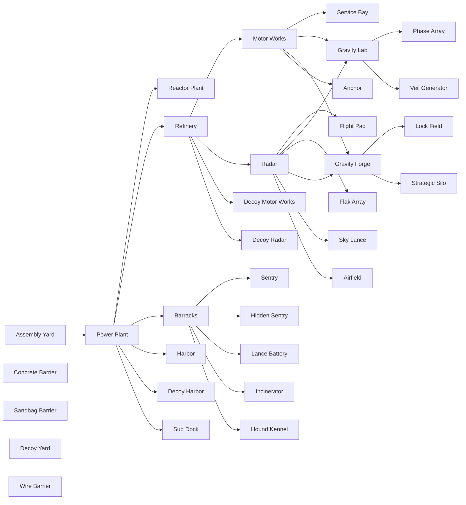

<!-- GENERATED from design/balance.xlsx by packages/rules/scripts/import-balance.mjs. Do not edit by hand. -->

# Tech tree

Progression: **Establish → Economy → Warfare → Advanced → Strategic**. Prerequisites are building IDs; a building
or unit is available once you own (a finished copy of) every prerequisite. `a | b` means either.

## Establish

**Buildings:** Assembly Yard; Power Plant ← Assembly Yard

**Units:** Rifleman @ Barracks; Grenadier (Sable) @ Barracks

## Economy

**Buildings:** Refinery ← Power Plant; Barracks ← Power Plant; Decoy Yard (Ordan)

**Units:** Harvester @ Motor Works + Refinery

## Warfare

**Buildings:** Motor Works ← Refinery; Radar ← Refinery; Concrete Barrier; Harbor (Ordan) ← Power Plant; Sentry (Ordan) ← Barracks; Hidden Sentry (Ordan) ← Barracks; Lance Battery (Ordan) ← Barracks; Sandbag Barrier (Ordan); Decoy Motor Works (Ordan) ← Refinery; Decoy Harbor (Ordan) ← Power Plant; Decoy Radar (Ordan) ← Refinery; Sub Dock (Sable) ← Power Plant; Incinerator (Sable) ← Barracks; Hound Kennel (Sable) ← Barracks; Wire Barrier (Sable)

**Units:** Lancer @ Barracks; Engineer @ Barracks; Lander @ Harbor/Sub Dock; Medic (Ordan) @ Barracks; Hound (Sable) @ Hound Kennel; Skimmer (Ordan) @ Motor Works; Jackal (Ordan) @ Motor Works; Ram (Ordan) @ Motor Works; Carrier (Ordan) @ Motor Works + Barracks; Goliath (Sable) @ Motor Works; Salvo (Sable) @ Motor Works + Radar; Cutter (Ordan) @ Harbor; Wraith (Sable) @ Sub Dock

## Advanced

**Buildings:** Reactor Plant ← Power Plant; Service Bay ← Motor Works; Flight Pad ← Radar; Gravity Lab (Ordan) ← Motor Works + Radar; Flak Array (Ordan) ← Radar; Veil Generator (Ordan) ← Gravity Lab; Gravity Forge (Sable) ← Motor Works + Radar; Anchor (Sable) ← Motor Works; Sky Lance (Sable) ← Radar; Airfield (Sable) ← Radar

**Units:** Operator @ Barracks + Gravity Lab/Gravity Forge; Seeder @ Motor Works + Service Bay; Infiltrator (Ordan) @ Barracks + Radar; Raider (Ordan) @ Barracks + Gravity Lab; Breaker (Sable) @ Barracks + Gravity Forge; Spire (Ordan) @ Motor Works; Watcher (Ordan) @ Motor Works + Radar; Shroud (Ordan) @ Motor Works + Gravity Lab; Anvil (Sable) @ Motor Works + Gravity Forge; Drift (Ordan) @ Flight Pad; Shrike (Sable) @ Airfield; Interceptor (Sable) @ Airfield; Lifter (Sable) @ Flight Pad; Hammer (Sable) @ Flight Pad; Warden (Ordan) @ Harbor; Bastion (Ordan) @ Harbor + Gravity Lab

## Strategic

**Buildings:** Phase Array (Ordan) ← Gravity Lab; Lock Field (Sable) ← Gravity Forge; Strategic Silo (Sable) ← Gravity Forge

**Units:** Assembler @ Motor Works + Service Bay

## Building dependency graph

